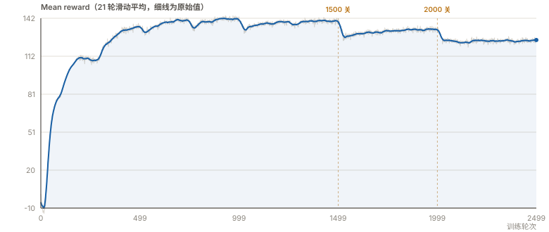
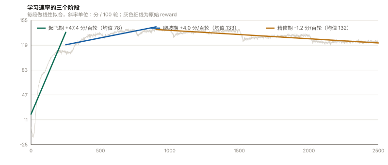
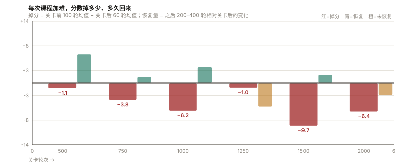
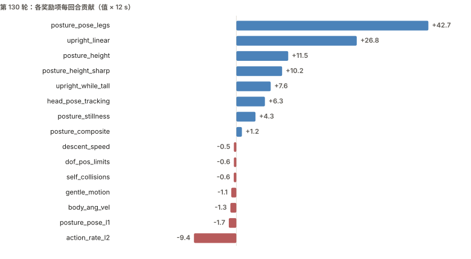

Microduck · 强化学习实战 · 第二课

# 第二课：训练一只会「坐下」和「起立」的机器鸭

> 第一课训的是走路。这一课换个任务，看训练流程是不是通用的——所以我选了 **SitStand**：给它一个开关，`1` 坐下，`0` 站起来。结果：**1 小时 14 分钟，2500 轮，策略能从站姿坐到底、再从坐姿站起来。**

**📦 上一篇：[从零训练一只会走路的机器人鸭子](./README.md)** —— 这篇默认你已经有一个能跑 Microduck 的云实例。

---

## 一、这次要训什么

| 项目 | 内容 |
| --- | --- |
| 任务 | `Mjlab-SitStand-Flat-MicroDuck` |
| 指令 | `[sit_flag, 0, 0]`，`0` = 站，`1` = 坐 |
| 回合 | 12 秒，指令每 3.5–6.5 秒可能翻转一次 |
| 目标 | 一个策略同时会坐、会站，听指令切换 |

和走路最大的区别：走路只要「往前走」，坐起要求**精确停在某个姿态上**，再从这个姿态把自己撑回去。所以这次不只要看它动没动，还要看它**停得准不准、撑得稳不稳**。

**为什么选这个任务**：官方文档 `docs/sitstand_policy.md` 记录它是从零训练、跑在 4090 上、1250 轮就能拿到可部署的权重。时长可控，有官方参照，适合当第二个任务。

---

## 二、怎么跑：五步

```bash
bash /root/duck_next.sh 1-check      # ① 环境自检
bash /root/duck_next.sh 2-smoke      # ② 5 轮烟测
bash /root/duck_next.sh 3-train      # ③ 正式训练（后台，可关终端）
bash /root/duck_next.sh 4-watch      # ④ 看进度
DUCK_RUN=microduck_sitstand bash /root/duck_next.sh 5-record   # ⑤ 录一段看结果
```

### 每步在确认什么

| 步骤 | 确认什么 | 通过标志 | 耗时 |
| --- | --- | --- | --- |
| ① 自检 | 依赖齐、`WANDB_MODE=offline` | 打印 `WANDB_MODE = offline` | 1 分钟 |
| ② 烟测 | 整条链路通（**不验证会不会坐**） | `Learning iteration 4/5` + 「✓ 通过」 | 3 分钟 |
| ③ 训练 | 真正学技能 | 日志持续输出，每 250 轮存 checkpoint | 约 2 小时 |
| ④ 看进度 | 有没有跑歪 | `Mean reward` 在涨 | 随时 |
| ⑤ 录视频 | 技能是真的存在 | 生成 mp4 | 5 分钟 |

### 三个必须知道的设定

**1. 轮数设 4000**

这个任务的难度是**分档**加的，最后一档排在 2500 轮。如果总轮数就设 2500，等于最后一档排上了、一天没练。设 4000 让最后一档之后还有 1500 轮余量。

> 我这次实际只跑了 2500 轮（当时没意识到），所以下面的数据都是 2500 轮的。跑完明显看出最后一档没吃到，这也是我唯一后悔的一个决定。

**2. 训练进程和终端无关。**

`nohup` 起的进程独立跑，关掉 SSH 不影响，checkpoint 照常落盘。回来看进度：控制台 → JupyterLab → 新建终端。

---

## 四、结果一：它真的学会了吗

这是这一课的核心问题。训练日志里的 reward 只能说明「分数高了」，不能说明「技能存在」。**验证技能得看动作本身。**

**降了一阶来看**：让策略在一个回合里连续跑，记录躯干高度（trunk z）。站姿和坐姿的高度差是明确的：

| 状态 | 躯干高度 z |
| --- | --- |
| 站姿 | ≈ 0.117 m |
| 坐姿 | ≈ 0.062 m |
| 落差 | ≈ 55 mm |

实测一个回合里的轨迹（高度值，间隔 1 秒）：

```bash
指令 flag=1（坐下）→ z 从 0.117 开始下降
    0.117 → 0.081 → 0.063          ← 2 秒内完成坐下，落到 0.063
指令 flag=0（起立）→ z 回升
    0.062 → 0.117                   ← 完整站回
```

**一个完整循环，两个方向，高度都对得上。** 这不是「看起来在动」，是躯干真的位移了 55 mm 然后回到原位。

同一个回合里连续跑多次，都能复现 4 个完整循环。所以结论是明确的：

> **技能真实存在，不是 reward 曲线造成的错觉。**

---

## 五、结果二：训练曲线怎么读

### 5.1 主曲线



三个关键点：

- **第 16 轮 −14.71（全程最低）**：开局完全不会动，站着就摔，动作惩罚一直在扣，所以是负分。第 28 轮转正。
- **第 931 轮 144.41（全程峰值）**：之后没再回去。
- **第 2499 轮 124.27（终点）**。

**峰值之后一路下降到终点，这不代表退化。** 下面三张图分别回答「为什么涨、为什么掉、到底稳不稳」。

### 5.2 学习速率：2500 轮里真正有用的只有前 900 轮

把曲线分段做线性拟合，斜率就是「每 100 轮涨多少分」：



| 阶段 | 斜率 | 段内均值 | 说明 |
| --- | --- | --- | --- |
| **起飞期**（0–250 轮） | **+47.4 分/百轮** | 78.15 | 从不会动到会坐会站，全在这里 |
| **爬坡期**（250–900 轮） | +4.0 分/百轮 | 132.68 | 精度打磨，涨幅只有起飞期的 1/12 |
| **精修期**（900–2500 轮） | **−1.2 分/百轮** | 132.02 | 分数**不再上涨**，甚至缓降 |

这张图是整篇分析里信息量最大的一张：

**1. 前 250 轮就完成了主要学习。** 47.4 对 4.0，差一个数量级。250 轮只占全程 10%，却贡献了几乎全部能力增长。

**2. 900 轮之后斜率转负，但同期课程一直在加难**（见 5.3）。所以「分数不涨」至少有两种可能：策略没进步，或者策略在进步的同时被更难的考卷压住了。**光看这条曲线分不开这两种情况**——这也是为什么下面必须单独量化每一次关卡。

**3. 「训得越久分数越高」在这个任务是错的。** 900 轮之后分数不会再涨，甚至缓降。后面 1600 轮买到的东西不是分数，而是**在更严格条件下的稳定性**（5.4 节的波动数据可以部分佐证这一点）。

> 💡 **实用推论**：想快速拿到能用的策略，**1000 轮左右就够**。官方说 1250 轮拿到可部署权重，和这里的拐点（900–1250）基本吻合。后面的轮次买的是鲁棒性，不是能力。

### 5.3 每次课程加难，掉多少分、多久回来

把六个跳变点逐个量化（掉分 = 关卡前 100 轮均值 − 关卡后 60 轮均值）：



| 关卡 | 前 100 轮 | 后 60 轮 | 掉分 | 之后 200–400 轮 |
| --- | --- | --- | --- | --- |
| 500 | 133.65 | 132.51 | −1.14 | **+6.47** ✓ 恢复并超过 |
| 750 | 140.24 | 136.46 | −3.78 | +1.31 ✓ |
| 1000 | 141.71 | 135.46 | −6.25 | +3.52 ✓ |
| 1250 | 138.72 | 137.71 | −1.02 | **−5.30** ✗ 继续跌 |
| **1500** | 140.08 | 130.41 | **−9.67** | +1.81 ≈ 打平 |
| **2000** | 133.12 | 126.69 | **−6.43** | **−2.67** ✗ 未恢复 |

三件事：

**1. 掉的幅度和课程强度成正比。** 500 / 1250 只掉 1 分左右（那两次调的是中间档）；1500 掉 **9.67 分**，是全程最重的一次——那一次同时加了动作平滑终值、push 扰动、`rise_speed`、坐姿 jerk 四样。

**2. 前三次都能恢复，后两次没有。** 500 / 750 / 1000 之后都回到甚至超过关卡前水平；从 1250 起恢复开始失效。

**3. 这解释了终点为什么是 124.27。** 不是「训到最后只剩 124」，而是「考卷一路变难，分数被压在 124」。

> ⚠️ **与官方文档的出入**：官方说 "recovering within each stage"，我实测 1250 和 2000 之后没恢复。没找到解释，只给数据，不下结论。

### 5.5 分数从哪来——策略的「性格」



第 130 轮的奖励构成（每项 × 12 秒 = 每回合贡献）：

| 占比 | 来源 |
| --- | --- |
| **45%** | `posture_pose_legs` —— 腿部关节贴住目标姿态 |
| **28%** | `upright_linear` —— 躯干保持直立 |
| **23%** | 高度相关项 —— 躯干高度、站高时直立 |
| **−10%** | `action_rate_l2` —— 动作抖动罚分 |

**73% 的分来自「保持住姿态」。** 这解释了第四节说的「响应慢」——在它的评分体系里，稳住比快更值钱。想让它响应更快，改的是配方（权重），不是去调已训好的权重。

> 💡 还有个反直觉的：`rise_speed`（起立速度）**不是奖励起立快，是惩罚起立太快**。1500 轮后才开启，作用是防止猛地弹起来、后跟翻过去。字段名不能按字面理解。

---

## 六、结果三：核心指标对照

| 项目 | 结果 |
| --- | --- |
| 并行环境 | 4096 |
| 轮数 | 2499 / 2500 |
| 耗时 | 1 小时 14 分钟 |
| 每轮耗时 | 1.75 – 1.81 秒 |
| 训练速度 | 约 5.5 万步/秒 |
| 显存占用 | 约 17.2 GB（RTX 4090） |
| 最终 reward | 1.11 → **124.27** |
| 峰值 reward | **144.41** @ 931 轮 |
| 躯干高度跨度 | 0.117 m ↔ 0.062 m（55 mm） |
| 可复现的完整坐↔站循环 | 单回合内连续 4 次 |
| 产物 | 每 250 轮一个 checkpoint + 完整日志 |

**这组数字里，最值得看的是最后两行。** reward 124.27 只能说明「学得不错」，躯干高度 55 mm 的往复才能说明「技能存在」。

---

<figure>
  <video controls preload="metadata" playsinline width="100%">
    <source src="./images/sitstand-flag-check.mp4" type="video/mp4">
    你的浏览器不支持 video 标签，<a href="./images/sitstand-flag-check.mp4">点此下载视频</a>。
  </video>
  <figcaption><strong>坐↔站回放 · 20 秒</strong><br>
  训练产出的策略在仿真里连续运行。躯干高度在站姿（≈0.117 m）与坐姿（≈0.062 m）之间往复，
  落差约 55 mm —— 这是「技能真实存在」最直接的证据。</figcaption>
</figure>

## 写在最后

这篇的主线其实很简单：

```bash
跑起来 → 确认跑满 → 验证技能存在 → 读曲线判断好坏 → 对照指标
```

其中**「验证技能存在」这一步最容易跳过**，也最容易出问题——因为训练日志不会告诉你这件事，它只告诉你分数。

第一课我用「看视频里鸭子走没走」来验证，这一课用「量躯干高度」来验证。**形式不同，但都需要一个独立于 reward 的证据。**

---

## 参考资料

- [pollen-robotics/microduck\_rl](https://github.com/pollen-robotics/microduck_rl) — 官方训练仓库（Apache-2.0）
- 仓库内 `docs/sitstand_policy.md` — 官方的 SitStand 训练记录
- [Microduck Sandbox](https://huggingface.co/spaces/pollen-robotics/microduck-simulator) — 官方浏览器沙盒
- [算力自由 gpufree.cn](https://www.gpufree.cn/) — 本次使用的云 GPU 平台

---

*训练数字来自本次实跑日志（2500 轮完整记录），图表由日志直接生成。躯干高度数据来自单独的策略回放记录（无渲染，逐秒采样）。*
